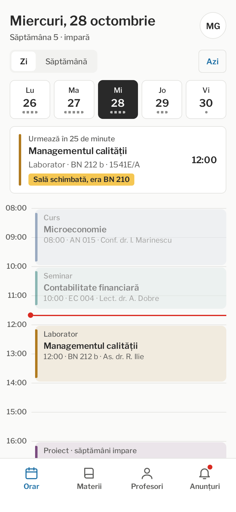
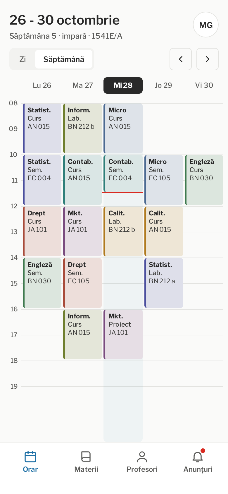
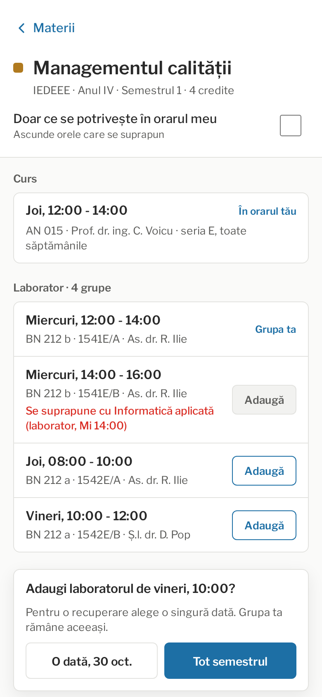
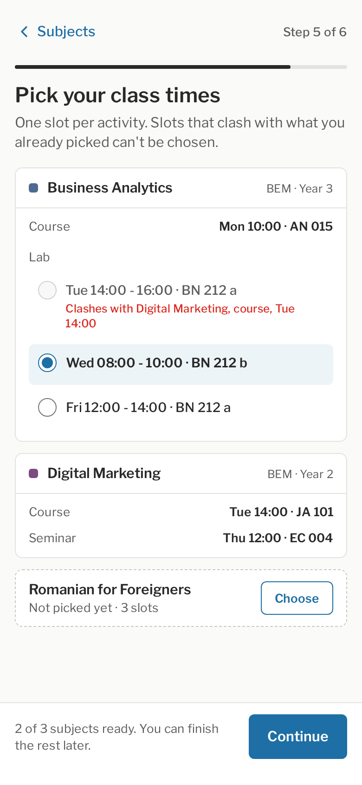

# UNSTPB eTimetable

A timetable app for students of FAIMA (the Faculty of Entrepreneurship,
Business Engineering and Management) at the National University of Science
and Technology POLITEHNICA Bucharest. It shows your classes, where each
professor is and the faculty's announcements, on Android and iOS, and keeps
working offline once the timetable has synced.

Developed and owned by Multimedia Entertainment Hub LLC, on commission from
FAIMA, UNSTPB.

Status: early development. The project skeleton builds and runs; the timetable itself is not there yet.

## What it does

- National students pick their group once and get the timetable the faculty
  publishes for it.
- Erasmus students build their own timetable from the subjects in their
  learning agreement, across specializations and years. The app refuses a
  slot that overlaps one already picked.
- Every subject has a page with all its course and lab slots, rooms and
  professors, so you can go to another group's lab or recover a missed one.
- A professor timetable: what each professor teaches, where and when, and
  their office hours.
- Faculty announcements with push notifications.
- Home screen widgets with today's classes and the next one.
- Native apps: Jetpack Compose on Android, SwiftUI on iOS, with the
  timetable logic shared in Kotlin.

## Screens

These are the approved designs, not screenshots of a finished app yet.

All ten screens, including dark mode, the widgets and the sign-in and About
pages, are in [design/mockups](design/mockups). The colours, type and logo
rules are in [docs/design.md](docs/design.md).

## Why we are making it

FAIMA asked us, the developers at Multimedia Entertainment Hub, for a
timetable app. The prototype we were shown had the right screens, but it was
a web page and looked generated.

We want an app that opens instantly, works in a lecture hall with no signal,
and looks like something the faculty would put its name on.

## What works

- The Android app starts, uses the design's colours and font, and checks
  that it can reach the server.
- The server stores semesters, announcements and student accounts in
  PostgreSQL and serves them over its API, with Erasmus overlaps checked on
  the server too. It runs from a Docker image next to PostgreSQL.
- The faculty's dashboard at `/admin`: semesters and their holidays, the
  timetable imported from one spreadsheet (and exported back to it),
  announcements and dashboard accounts.
- The shared Kotlin code computes timetables, week numbers and clashes, and
  keeps an offline copy on the phone.
- The iOS app builds on CI and shows the app name from the shared Kotlin
  code. Nobody on the team has a Mac yet, so it has not run on a device.

Everything else is still to come. The requirements are in
[docs/brief.md](docs/brief.md) and the planned design in [docs/architecture.md](docs/architecture.md), including
the questions that are still open.

## Install

Not available yet. Test builds will appear on the releases page first, then
in Google Play and the App Store.

## How it works

A Kotlin Multiplatform module holds the data model, the sync and the
schedule logic (overlap checks, week parity, "what is next"), with a local
SQLite database so everything works offline. The Android app and widget are
written with Jetpack Compose and Glance, the iOS app and widget with SwiftUI
and WidgetKit, and both call the shared module directly. A Kotlin server,
shipped as a Docker image the university runs itself, serves the timetable,
holds student accounts, sends push notifications and has the dashboard where
the faculty enters each semester's timetable. Details in
[docs/architecture.md](docs/architecture.md).

## Roadmap

1. Design: screens and colors, agreed before any UI code.
2. Project skeleton and CI for the apps and the server.
3. Shared module: data model, week rules, overlap check, offline store.
4. Server: API, accounts, admin dashboard, Docker image.
5. Android app and widget, then push notifications.
6. iOS app and widget.
7. First release: Android build, server image and deployment notes.

## Contributing

Collaborators work on branches in this repository, everyone else through a
fork. [CONTRIBUTING.md](CONTRIBUTING.md) has the build steps and the pull
request flow, and [AGENTS.md](AGENTS.md) the rules every change follows.

## License

Copyright (c) 2026 Multimedia Entertainment Hub LLC. All rights reserved.
The source is public so it can be read and reviewed, but you may not copy,
change, redistribute or publish the app or its code without written
permission from MEH. See [LICENSE](LICENSE).

The UNSTPB and FAIMA names and logos belong to the university.
